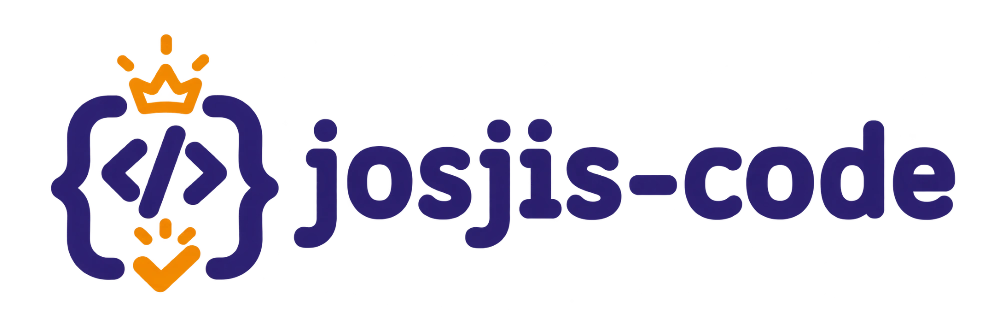

<p align="center">
  
</p>

Agent skills for team codebases. Four skills that work together:

| Skill | What it does |
|---|---|
| `readme` | Generates or completes a README from a template matched to the project type (backend, frontend, fullstack, mobile). `--diff` updates only sections touched by your branch. |
| `docs-init` | Bootstraps agent-ready docs in `docs/` plus an `AGENTS.md` entry point: architecture, folder map, conventions, and end-to-end flows. Marks what it cannot derive from code and asks you. |
| `implement` | Adds or changes a feature following docs first, then the code graph, then existing code patterns. Stops on doc/code conflicts, warns before large changes, updates docs afterwards. |
| `risk-scan` | Finds unhandled errors and crash/panic risks. Scans your branch diff, the whole repo (`--all`), or a path. Writes a dated report to `docs/risk-scan/` and tracks what got resolved. |

```
docs-init ──► docs/ ──► implement (follows docs, then updates them)
                  └───► risk-scan (reads conventions) ──► fix with implement
```

## Install

### Claude Code

```
/plugin marketplace add tamaplus/josjis-code
/plugin install josjis-code@josjis-code
```

Then use `/josjis-code:readme`, `/josjis-code:docs-init`, `/josjis-code:implement`, `/josjis-code:risk-scan`, or just ask ("scan this branch for unhandled errors").

### Other agents

Each skill is a folder under `skills/` with a `SKILL.md`. Copy the folders into your agent's skills directory, or point your agent at them.

## Usage

```
/josjis-code:readme                     # detect type, create or complete README
/josjis-code:readme --type mobile       # force a template
/josjis-code:readme --diff              # update sections affected by this branch

/josjis-code:docs-init                  # create docs/ and AGENTS.md

/josjis-code:implement add pagination to GET /orders

/josjis-code:risk-scan                  # scan branch diff
/josjis-code:risk-scan --all            # scan whole repo (asks first)
/josjis-code:risk-scan services/payment # scan a path
```

## Customizing

- **Your own README template**: put it at `.github/README_TEMPLATE.md`, `docs/README_TEMPLATE.md`, or `README.template.md`. It overrides the built-in templates.
- **Error-handling rules**: document them in `docs/conventions.md` (or `AGENTS.md`). `risk-scan` and `implement` read them.

## Optional tools

- **Codegraph**: if a code graph index is available, `docs-init`, `implement`, and `risk-scan` use it to trace flows and rank risk by reachability. Without it they fall back to search and reading files.
- **Linters**: `risk-scan` runs language linters when installed (golangci-lint, staticcheck, errcheck, nilaway, eslint, tsc, ruff, mypy, clippy, SwiftLint, detekt, PHPStan, ...). If missing, it tells you and asks before continuing without them. It never installs anything.

## Language support (risk-scan)

JavaScript/TypeScript (Node, React, Vue, Next, Nuxt), Python, Java/Kotlin (incl. Android), Go, C#, PHP, Rust, Swift. Other languages get the language-agnostic core checklist.

Contributions of new checklists are welcome: add `skills/risk-scan/checklists/<language>.md` and a row in the table in `skills/risk-scan/SKILL.md`.

## What these skills never do

- Commit, push, or create branches
- Copy secret values from `.env` or config files into docs
- Install tools
- Rewrite existing README or docs content (they add, and flag suspected stale parts)

## License

MIT
